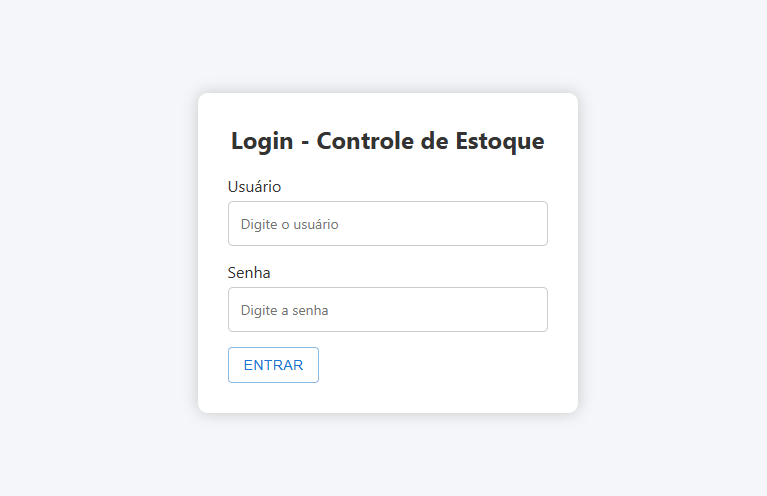
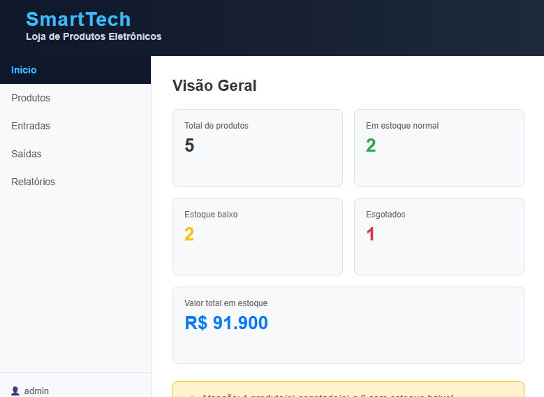

# 📦 Smart Tech — Sistema de Controle de Estoque

Sistema web demonstrativo de controle de estoque desenvolvido com **React, JavaScript e Vite**. O projeto reúne cadastro de produtos, movimentações de estoque e relatórios em uma interface de gerenciamento.

## 🚀 Funcionalidades

- Acesso ao **modo demonstração**, sem necessidade de senha.
- Dashboard com resumo e indicadores do estoque.
- Cadastro, edição, exclusão e listagem de produtos.
- Identificação de produtos com estoque normal, baixo e esgotado.
- Registro de entradas e saídas.
- Relatórios de produtos, movimentações e valor total em estoque.
- Armazenamento local de produtos e movimentações por meio do `localStorage`.

## 🛠️ Tecnologias

- **React** — componentes da interface.
- **JavaScript** — lógica da aplicação.
- **Vite** — ambiente de desenvolvimento e build.
- **Material UI (MUI)** e **Emotion** — componentes e estilos.
- **React Router** — navegação.
- **ESLint** — verificação estática do código.

## 📸 Capturas de tela

### Tela de acesso à demonstração



### Painel de controle de estoque



## ⚙️ Como executar localmente

**Pré-requisitos:** Node.js compatível com o Vite utilizado e npm.

1. Clone este repositório:

   ```bash
   git clone https://github.com/pedro1217/smart-tech-estoque.git
   ```

2. Entre na pasta do projeto:

   ```bash
   cd smart-tech-estoque
   ```

3. Instale as dependências:

   ```bash
   npm install
   ```

4. Inicie a aplicação:

   ```bash
   npm run dev
   ```

5. Abra no navegador o endereço exibido pelo Vite (geralmente `http://localhost:5173/`).

### Outros comandos

```bash
npm run lint
npm run build
npm run preview
```

## 📁 Organização do projeto

- `src/components/` — componentes de produtos, entradas, saídas, relatórios e navegação.
- `src/page/` — páginas de acesso e dashboard.
- `src/assets/` — recursos utilizados pela interface.
- `public/` — arquivos públicos.
- `docs/imagens/` — capturas de tela para a documentação.

## 🔐 Aviso sobre o modo demonstração

O acesso ao dashboard utiliza um indicador salvo no `localStorage` do navegador. **Isso não constitui autenticação segura.** O sistema foi criado como projeto de estudo e demonstração; não deve ser utilizado para controlar dados sensíveis ou estoques reais sem um back-end com autenticação e validação apropriadas.

Os dados de estoque também ficam armazenados localmente no navegador, e não em um banco de dados remoto.

## 👨‍💻 Desenvolvedor

Projeto desenvolvido para estudo e composição de portfólio na área de Desenvolvimento de Sistemas.

**GitHub:** [@pedro1217](https://github.com/pedro1217)

---

⭐ Projeto de aprendizado em desenvolvimento web com React.
